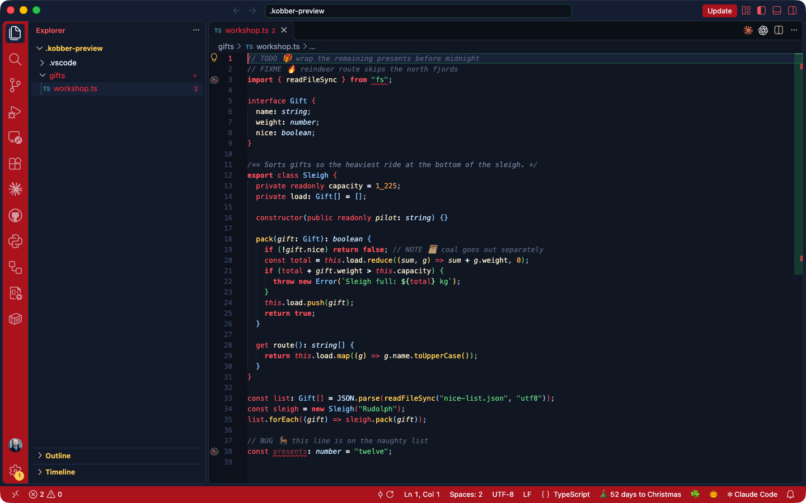
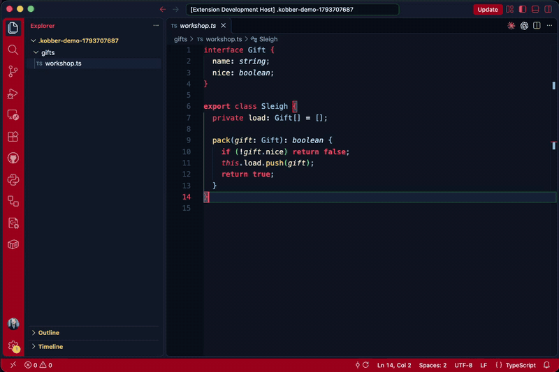

# 🎄 Christmas Theme



A cozy VS Code color theme for Christmas: Santa red, holly green and star gold on a silent-night navy sky.

## Color Palette

| Role | Color |
|------|-------|
| Background | `#0E1626` — silent-night navy |
| Activity Bar / Status Bar | `#B3121F` — Santa suit red |
| Keywords | `#FF5A65` — Santa red (bold) |
| Strings | `#6BD889` — holly green |
| Functions | `#FFD15C` — star gold |
| Types / Classes | `#8EC9FF` — frost blue |
| Numbers | `#F2A65A` — gingerbread |
| Namespaces | `#76E4D2` — mint |
| Comments | `#62708A` — frosted slate (italic) |
| Variables | `#F1E3C6` — eggnog |
| Foreground | `#F2F6FC` — snow white |

## Festive Details

- **Semantic highlighting** on: `self`/`cls` in Santa red, dunder methods frost blue, deprecated symbols struck through
- **Ghost text** (inline suggestions) and dead code fade into the snow
- **Bracket pairs** cycle red, frost blue, holly, gold, crimson, mint
- **Docstrings** whisper in dim italic; string quotes dim to deep holly
- **Menus, pickers, hovers** framed in pine green, badges in star gold
- **Diff / merge / git** in holly and crimson; tests pass holly, fail crimson
- **Terminal** 16-color palette: crimson, holly, gold, frost blue, peppermint, mint, eggnog

## Effects



Effects only run while 🎄 Christmas is the active color theme (setting `christmas.onlyWhenThemeActive`).

| Effect | What happens | Setting |
|--------|--------------|---------|
| Typing pops | Every 4th keystroke a 🎄 🎅 ❄️ 🎁 ⭐ 🦌 pops after the cursor and vanishes | `christmas.typingEffects.*` |
| Comment emojis | 🎁 TODO, 🔥 FIXME, 🦌 BUG, 🧝 HACK, 🧨 XXX, 📜 NOTE, ❄️ DEPRECATED / `@deprecated` | `christmas.commentEmojis.enabled` |
| Gutter icons | Lump of coal on error lines (naughty), jingle bell on warning lines | `christmas.gutterIcons.enabled` |
| Status bar | `🎄 53 days to Christmas`, click to cycle installed Kobber themes | `christmas.statusBar.enabled`, `christmas.cycleThemes` |
| Save messages | Occasional "🎅 Saved. Santa saw that." in the status bar | `christmas.saveMessages.enabled` |
| Snippets | `jolly` banner, `xmastree` ASCII art, `naughty` list TODO (any language with line comments) | |

Commands (`Cmd+Shift+P`): **Christmas: Let It Snow**, **Christmas: Toggle Typing Effects**, **Christmas: Cycle Color Theme**.

## Installation

### From VSIX (manual)
1. Download the `.vsix` file
2. Open VS Code → Extensions (`Ctrl+Shift+X`)
3. Click `...` → **Install from VSIX...**
4. Select the file and reload

### From source (development)
```bash
cd vscode-themes
code .
# Run and Debug → "Christmas Theme" → F5 to launch Extension Development Host
# Then: Command Palette → Color Theme → 🎄 Christmas
```

### Build VSIX
```bash
npm install -g @vscode/vsce
cd christmas-theme
vsce package
```

## License

MIT
